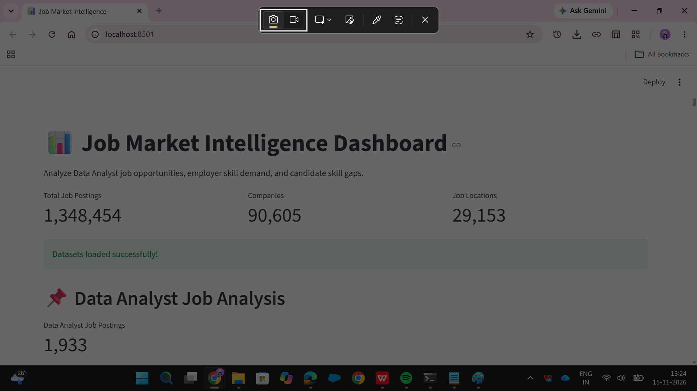

\# Job Market Intelligence \& Skill Gap Analyzer


A Python-based data analytics project that explores job market trends, identifies in-demand skills for Data Analyst roles, and compares market requirements with an individual's existing skills.
## Dashboard Preview




\## Project Overview


The Job Market Intelligence \& Skill Gap Analyzer helps users understand which skills employers frequently mention in Data Analyst job postings.


It analyzes job titles, companies, locations, and skill requirements to identify important market trends. It also provides a personalized skill gap analysis and learning roadmap based on the user's current skills.


\## Key Features


\- \*\*Job Market Analysis:\*\* Explore Data Analyst job postings and employer information.

\- \*\*Company Analysis:\*\* Identify companies appearing in the dataset.

\- \*\*Location Analysis:\*\* Compare job posting counts across locations.

\- \*\*Skill Demand Analysis:\*\* Identify the most frequently mentioned skills.

\- \*\*Personal Skill Gap Analysis:\*\* Compare user-entered skills against identified market requirements.

\- \*\*Learning Priorities:\*\* Highlight missing skills based on their market demand.

\- \*\*Personalized Learning Roadmap:\*\* Organize learning priorities and provide resource links.

\- \*\*Report Generation:\*\* Download skill gap reports in Excel and PDF formats.


\## Technologies Used


\- Python

\- Pandas

\- NumPy

\- Streamlit

\- Matplotlib

\- Seaborn

\- Plotly

\- OpenPyXL

\- ReportLab


\## Dataset


Source: \[LinkedIn Jobs and Skills Dataset – Kaggle](https://www.kaggle.com/datasets/asaniczka/1-3m-linkedin-jobs-and-skills-2024)


The project uses job posting and skill information from the dataset.


Download the required CSV files and place them in the following structure:


```text

Job\_Market\_Intelligence/

│

├── data/

│   ├── linkedin\_job\_postings.csv

│   └── job\_skills.csv

│

├── app.py

├── README.md

└── .gitignore

```


The raw datasets are excluded from this GitHub repository because of their large file sizes.


\## Installation and Setup


\### 1. Clone the repository


```bash

git clone https://github.com/psahithi74/Job-Market-Intelligence-Skill-Gap-Analyzer.git

```


\### 2. Navigate to the project folder


```bash

cd Job-Market-Intelligence-Skill-Gap-Analyzer

```


\### 3. Install the required libraries


```bash

pip install pandas numpy matplotlib seaborn plotly streamlit openpyxl reportlab

```


\### 4. Download the dataset


Download the required CSV files from Kaggle and place them inside the `data` folder.


\### 5. Run the application


```bash

python -m streamlit run app.py

```


The dashboard will open in your browser.


\## Project Workflow


1\. Load and explore job posting and skill datasets.

2\. Clean and prepare the data using Pandas.

3\. Identify Data Analyst job postings.

4\. Analyze job locations, companies, and skill demand.

5\. Compare user-entered skills with market requirements.

6\. Identify missing skills and prioritize learning.

7\. Generate downloadable Excel and PDF reports.


\## Project Outcomes


The application provides an interactive way to explore job market requirements, understand skill gaps, and plan targeted learning activities using data-driven insights.


\## Future Enhancements


\- Add more job roles such as Data Scientist and Business Analyst.

\- Include additional job market datasets.

\- Add advanced trend analysis and visualizations.

\- Improve personalized learning recommendations.

\- Integrate regularly updated job posting data.


\## Author


\*\*Sahithi\*\*


GitHub: \[@psahithi74](https://github.com/psahithi74)

